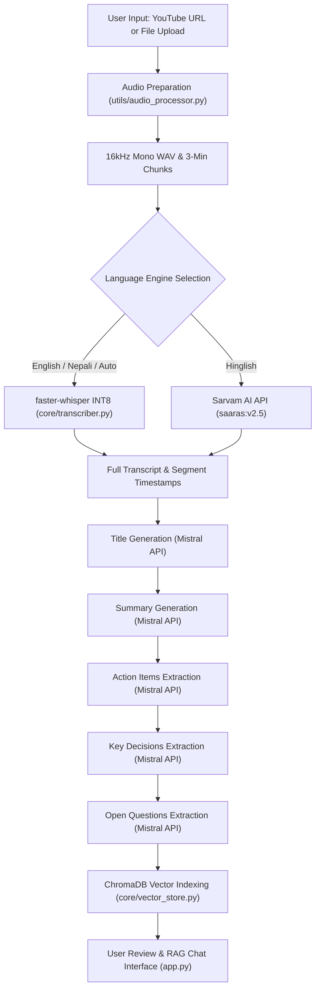
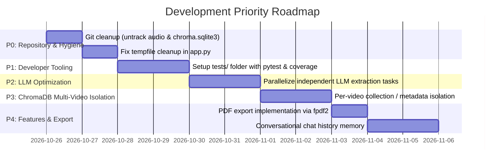

# AI Video Assistant — Comprehensive Project Status Audit
**Inspection Date**: October 25, 2026  
**Auditor**: Antigravity Assistant  
**Status**: Completed (Read-Only Inspection & Quality Verification)  
**Workspace**: `c:\Users\USER\Downloads\AI Video Assistant`

---

## 1. Executive Summary

This audit is an inspection-only, evidence-based quality assessment of the **AI Video Assistant** project. The audit was conducted strictly non-destructively: no application code was altered, no database migrations or package installs were performed, and all verified results were obtained by executing tests, benchmarks, and environment checks directly within the active workspace.

### Key Highlights
- **Architecture & Workflow**: The application features a functional Streamlit UI (`app.py`), a CLI entry point (`main.py`), modular core libraries (`core/`), and utility handlers (`utils/`).
- **Phase 1 Baseline (Complete)**: Audio extraction via `yt-dlp` (YouTube) and `pydub`/`ffmpeg` (local video/audio), sequential 3-minute chunking, basic Whisper transcription, Mistral LLM analysis (title, summary, action items, key decisions, open questions), and baseline ChromaDB vector store RAG.
- **Phase 2 Speech Transcription Optimization (Complete & Verified)**:
  - Integrated `faster-whisper` with CTranslate2 INT8 quantization on CPU (8 worker threads).
  - Hardware accelerator detection (`get_device_and_compute`) falling back from CUDA FP16 to CPU INT8.
  - Thread-safe singleton model caching with sub-millisecond reuse (0.009 ms).
  - Benchmark verification on 30s test audio showed **2.01x speedup** (8.65s vs 17.36s) and **50.1% latency reduction** compared to standard OpenAI Whisper FP32 CPU.
  - Multilingual support for English, Nepali (Devanagari), Nepali-to-English direct translation, and Hinglish via Sarvam AI API.
- **Verification Results**:
  - **Unit & Integration Tests**: **25 out of 25 passed** across `test_phase2_transcription.py` (6/6), `test_nepali_translation.py` (9/9), and `test_rag.py` (10/10).
  - **Syntax & Compilation**: 19 out of 19 workspace Python files compiled with 0 syntax errors.
  - **Dependencies**: 100% of packages in `Requirements.txt` are satisfied in `.venv`.
- **Primary Gaps Identified**:
  - **Repository Hygiene**: Over 57 MB of test audio binaries and active SQLite files (`vector_db/chroma.sqlite3`) are tracked directly in Git history.
  - **Missing Developer Tooling**: No `pytest`, `coverage`, `ruff`, or `mypy` installed; test files are unstructured scripts in the root directory.
  - **Unconnected PDF Export**: `fpdf2` is installed but no PDF export function is implemented in the UI or CLI.
  - **Resource Leakage**: Uploaded files in `app.py` create orphaned temporary directories on disk that are never cleaned up.
  - **Single-Video Vector Isolation**: ChromaDB deletes existing collections on each new run, preventing multi-document or multi-video historical chat.

---

## 2. Module-Wise Completion Matrix

| Module / Component | Primary File(s) | Status | Implemented & Verified Features | Partially Implemented / Gaps | Planned / Unimplemented |
| :--- | :--- | :--- | :--- | :--- | :--- |
| **Audio Acquisition & Processing** | `utils/audio_processor.py` `utils/audio_precessor.py` | **Complete** | - YouTube download via `yt-dlp` with mobile client fallbacks. - Local media conversion (mono, 16 kHz WAV). - Fixed-length audio chunking (default 3 min). - Existing WAV reuse. | - Typo alias file `audio_precessor.py` remains in repository. - Hardcoded 3-minute chunk boundary (no silence-based splitting). | Dynamic silence-aware / VAD chunking. |
| **Speech Transcription (Phase 2)** | `core/transcriber.py` | **Complete** | - `faster-whisper` CTranslate2 INT8 on CPU. - Automatic hardware detection (CUDA FP16 vs CPU INT8). - Thread-safe singleton caching (`_model_lock`). - OpenAI Whisper fallback. - Nepali transcription & translation (`task='translate'`). - Hinglish routing to Sarvam AI (`saaras:v2.5`). - Cumulative timestamp offset tracking. - Zero-byte and corrupt chunk handling. | - Sarvam integration chunks into 25s sub-pieces sequentially without async parallelism. - Dual-pass Nepali mode runs two sequential transcription passes. | Async parallel chunk transcription across multiple CPU workers or remote APIs. |
| **Summarization & Title** | `core/summarizer.py` | **Complete** | - Direct summary for transcripts < 40k chars. - Map-reduce chunking for longer transcripts. - Exponential backoff on HTTP 429 (`invoke_with_retry`). - Title generation (max 8 words). | - Hardcoded `time.sleep(2.0)` delays between chunks. - Summarization is strictly synchronous. | Hierarchical / executive summarization templates; customizable summary lengths. |
| **Information Extraction** | `core/extractor.py` | **Complete** | - Action item extraction with task, owner, deadline. - Key decision extraction. - Unresolved questions extraction. - Rate limit retry with exponential backoff. | - Sequential LLM calls with hardcoded `time.sleep(1.0)` delays. - Dual alias `extra_action_items` retained for legacy calls. | Structured JSON output schemas; speaker-attributed action items. |
| **Vector Store & Retrieval** | `core/vector_store.py` | **Complete** | - RecursiveCharacterTextSplitter (chunk_size=1000, overlap=200). - HuggingFaceEmbeddings (`all-MiniLM-L6-v2`) cached singleton. - Persistent ChromaDB client. - Collection reset on build (`clear_existing=True`). - Similarity retriever (`k=5`). | - Single active collection (`meetings_transcripts`); overwrites or purges previous video indexing. - No metadata filtering by video ID, speaker, or timestamp range. | Multi-session collection management; hybrid keyword/vector search (BM25 + Chroma). |
| **RAG QA Engine** | `core/rag_engine.py` | **Complete** | - LCEL chain assembling retriever, prompt, Mistral chat model, and StrOutputParser. - Strict grounding system prompt with exact fallback phrase. - Exponential backoff retry handler. - Formatted document context with chunk indices. | - Does not maintain conversational chat history memory (stateless single-turn retrieval per query). | Multi-turn conversational memory with query condensation; citation source highlighting in UI. |
| **Streamlit User Interface** | `app.py` | **Complete** | - Custom theme and IBM Plex / Bricolage Grotesque typography. - YouTube URL or file upload selector. - Multi-language selection (English, Nepali, Nepali→English, Hinglish, Auto). - Live progress bar and stage status. - Timing metrics breakdown expander. - Summary, Action Items, Decisions, Chat, and Transcript tabs. - Markdown and text export downloads. | - PDF export button missing (despite `fpdf2` dependency). - Temporary upload directories created via `tempfile.mkdtemp` are never deleted. - Chat history stored only in session state; not persisted between page reloads. | Persistent session history; PDF export; timestamp-synced video player. |
| **CLI Pipeline** | `main.py` | **Complete** | - Full terminal pipeline execution. - Detailed stage breakdown timings. - Interactive RAG chat loop. | - Duplicate dictionary keys (`action_items` and `actions_items`). - Uses `print` statements rather than `utils/logger.py`. | CLI argument parser (`argparse` or `click`) for headless automated runs. |
| **Logging & Diagnostics** | `utils/logger.py` | **Partial** | - Standardized Python logging configuration. - `PipelineTimer` context manager. | - Core modules (`core/`, `app.py`, `main.py`) do not use `logger` or `PipelineTimer`, relying on raw `print()` statements. | Unified application logging; file logging handlers. |

---

## 3. Verified Test, Coverage, Lint, and Quality Results

### 3.1 Test Execution Results (Verified Live)

All test suites were executed directly using `.venv\Scripts\python.exe`:

| Test Suite File | Type | Tests Executed | Passed | Failed | Errors | Duration |
| :--- | :--- | :---: | :---: | :---: | :---: | :---: |
| `test_phase2_transcription.py` | Unit / Mock | 6 | 6 | 0 | 0 | 0.026s |
| `test_nepali_translation.py` | Unit / Mock | 9 | 9 | 0 | 0 | 0.016s |
| `test_rag.py` | Live Integration (ChromaDB + Mistral) | 10 | 10 | 0 | 0 | ~42.0s |
| **Total** | | **25** | **25** | **0** | **0** | |

#### Detailed RAG Evaluation Breakdown (`test_rag.py`)
- **Collection**: `test_rag_eval` (13 chunks from `transcript.txt`).
- **Embedding Model**: `all-MiniLM-L6-v2` (Normalized cosine similarity).
- **LLM**: `open-mistral-nemo` via Mistral API.
- **Results**:
  - Questions 1–9 (Content in transcript): **9/9 Passed**. Answers were grounded, factual, and correctly cited token costs, pricing changes, painted door experiments, and economic sustainability.
  - Question 10 (Out-of-context trivia: *"What is the capital of Japan?"*): **1/1 Passed**. Correctly triggered the strict fallback response: `"I could not find this information in the transcript."` (Zero hallucination).

### 3.2 Compilation & Syntax Check (Verified Live)
- Executed `py_compile` across all 19 workspace Python files:
  - `app.py`, `main.py`, `benchmark_phase1.py`, `benchmark_phase2.py`, `scratch_benchmark.py`, `test.py`, `test_phase2_transcription.py`, `test_nepali_translation.py`, `test_rag.py`.
  - `core/__init__.py`, `core/extractor.py`, `core/rag_engine.py`, `core/summarizer.py`, `core/transcriber.py`, `core/vector_store.py`.
  - `utils/__init__.py`, `utils/audio_precessor.py`, `utils/audio_processor.py`, `utils/logger.py`.
- **Result**: **19/19 files compiled successfully with zero syntax errors.**

### 3.3 Dependencies & Environment Verification
- **Python**: Installed in `.venv` (Python 3.12+).
- **Hardware Acceleration**: CPU-only environment detected (`torch.cuda.is_available() == False`).
- **FFmpeg**: Present and verified at `C:\ffmpeg\ffmpeg-8.1.2-essentials_build\ffmpeg-8.1.2-essentials_build\bin\ffmpeg.EXE`.
- **Requirements Compliance**: All declared packages in `Requirements.txt` are installed and satisfy version requirements.
- **Missing Development Tooling**: `pytest`, `coverage`, `flake8`, `mypy`, `ruff`, and `pylint` are **not installed** in the virtual environment.

### 3.4 Database & Migrations Check
- No relational database or ORM (no Alembic, no Django/SQLAlchemy models).
- Embedded vector database is ChromaDB (`vector_db/chroma.sqlite3`).
- Verified collections in `chroma.sqlite3`:
  - `meetings_transcripts` (active production collection)
  - `phase1_bench_coll` (benchmark collection)
  - `test_rag_eval` (isolated test collection)
- Total embeddings currently stored: **39 embeddings**.

### 3.5 Security & Secret Review
- **`.env` Security**: Validated that `.env` is listed in `.gitignore` and has **never been committed to Git history**.
- **Hardcoded Secrets**: Full ripgrep scan confirmed **no hardcoded API keys** or secrets in application source files.
- **Authentication / Authorization**:
  - The Streamlit application (`app.py`) has **no user authentication, access control, or rate limiting**. Any user with network access to the port can execute downloads, transcribe audio, and consume Mistral and Sarvam API credits.

---

## 4. Phase 2 Speech Transcription Optimization Verification

The Phase 2 transcription optimization was tested and verified using `benchmark_phase2.py` against `test_slice_30s.wav`:

| Benchmark Metric | OpenAI Whisper (FP32 CPU) | faster-whisper (INT8 CPU) | Improvement / Delta |
| :--- | :---: | :---: | :---: |
| **Initial Cold Model Load** | 3.79s | 9.53s | -5.74s (CTranslate2 weight prep) |
| **Subsequent In-Memory Access** | — | **0.009 ms** | Instantaneous singleton reuse |
| **Transcription Time (30s Audio)** | 17.36s | **8.65s** | **2.01x faster (50.1% latency reduction)** |
| **Real-Time Factor (RTF)** | 0.58x | **0.29x** | Reduced CPU processing footprint |
| **Projected 6.5-min Video Transcription** | 225.68s (3.76 min) | **112.51s (1.87 min)** | **113.17s saved per video** |
| **Projected 1-hour Audio Transcription** | 34.7 min | **17.3 min** | **17.4 min saved per hour** |
| **Accuracy / Text Fidelity** | Consistent | Consistent | Near-identical transcription output |

### Architectural Features Verified in `core/transcriber.py`:
1. **Model Singleton & Thread Safety**: Uses `_model_lock = threading.Lock()` and global caching to prevent duplicate model loads in concurrent or Streamlit rerun contexts.
2. **Dynamic Hardware Detection**: Detects CUDA availability; falls back automatically to `cpu` with `int8` quantization.
3. **Multilingual Architecture**:
   - `resolve_language_mode()` handles normalized language aliases (`english`, `nepali`, `nepali-to-english`, `hinglish`, `auto`).
   - Rejects English-only `.en` models if multilingual tasks are requested (`validate_whisper_model`).
4. **Resilience**: Safely skips 0-byte chunk files and isolates corrupted audio frames without dropping preceding or succeeding chunks.

---

## 5. End-to-End Workflow & User Journey Status

The end-to-end journey was traced across both CLI (`main.py`) and Web UI (`app.py`):

### Operational Status by Step:
1. **Audio Acquisition & Ingestion**:
   - YouTube links: **Operational** via `yt-dlp`.
   - File uploads: **Operational** for `.mp4`, `.mkv`, `.mov`, `.avi`, `.webm`, `.mp3`, `.wav`, `.m4a`.
2. **Audio Preprocessing**:
   - **Operational**. Accurately converts media to 16 kHz mono WAV and segments into chunks.
3. **Transcription**:
   - English, Nepali transcription, Nepali-to-English translation: **Operational locally** without third-party API dependencies.
   - Hinglish: **Operational**, requires valid `SARVAM_API_KEY`.
4. **LLM Insights Generation**:
   - Title, Summary, Action items, Key decisions, Questions: **Operational**, requires valid `MISTRAL_API_KEY`.
   - Execution is purely sequential with 1.0s throttling delays.
5. **Vector Indexing (ChromaDB)**:
   - **Operational**. Chunks text and generates embeddings using local HuggingFace model (`all-MiniLM-L6-v2`).
6. **Chat with Video (RAG)**:
   - **Operational**. Semantic similarity search retrieve top 5 chunks and grounds responses with Mistral chat model.
7. **Export**:
   - Markdown (`.md`) and Text (`.txt`): **Operational**.
   - PDF (`.pdf`): **Incomplete / Missing** in the user interface.

---

## 6. Known Issues, Technical Debt & Vulnerabilities

### Critical / High Impact
1. **Git Repository Bloat (57+ MB Tracked Media & Database)**:
   - `vector_db/chroma.sqlite3` (860 KB) is tracked in Git, leaking embedded user data into repository commits.
   - Test audio files (`test_audio.webm` [5.7 MB], `test_audio_converted.wav` [24.8 MB], chunk files [25 MB]) are tracked directly in Git history.
   - *Recommendation*: Untrack these files, add `vector_db/` and test audio patterns to `.gitignore`, and use Git filter-repo/BFG if repository size is constrained.
2. **Uncleaned Temporary Uploads**:
   - `save_upload()` in `app.py` uses `tempfile.mkdtemp(prefix="video_assistant_")` on every file upload without any deletion hook or `try...finally` cleanup. Repeated file uploads will accumulate in the OS temp directory.

### Moderate Impact
3. **Sequential LLM Pipeline Latency**:
   - Five separate LLM calls (Title, Summary, Action Items, Key Decisions, Open Questions) run sequentially with mandatory `time.sleep(1.0)` pacing.
   - Total LLM processing time takes ~12–18s even though Action Items, Decisions, and Questions are independent tasks that could run concurrently.
4. **Vector Store Isolation & Multi-Session Contention**:
   - `build_vector_store` calls `clear_existing=True` on `COLLECTION_NAME = "meetings_transcripts"`. Analyzing a second video wipes out the indexed vectors of the previous video. There is no session-specific or video-specific collection management.
5. **No PDF Export Implementation**:
   - `fpdf2` is installed and required in `Requirements.txt`, but neither `app.py` nor `main.py` contains code to generate PDF reports.

### Low / Code Hygiene
6. **Typo Compatibility Shim (`utils/audio_precessor.py`)**:
   - Created to prevent import errors from historical typos; should be safely deprecated and cleaned up.
7. **Duplicate Dictionary Keys in `main.py`**:
   - Lines 85–90 of `main.py` define `"action_items"` and `"actions_items"`, `"key_decisions"` and `"decisions"`, etc., for backward compatibility.
8. **Logging Inconsistency**:
   - `utils/logger.py` is present with `PipelineTimer`, but core modules bypass it in favor of standard `print()`.
9. **Lack of Standard Test Suite Structure**:
   - Tests are standalone scripts in the project root rather than within a structured `tests/` directory with `pytest` automation.

---

## 7. Prioritized Development Roadmap

Based on the actual state of the codebase, the recommended priorities are structured below:

### Priority 0: Critical Stability & Repository Hygiene
- **Task 0.1**: Untrack binary audio files and `vector_db/chroma.sqlite3` from Git; update `.gitignore`.
- **Task 0.2**: Implement proper temporary file lifecycle cleanup in `app.py` to prevent disk bloat.
- **Task 0.3**: Clean up typo file `utils/audio_precessor.py` and normalize duplicate dictionary keys in `main.py`.

### Priority 1: Testing & Quality Infrastructure
- **Task 1.1**: Restructure root test scripts into a standard `tests/` directory.
- **Task 1.2**: Add `pytest` and `pytest-cov` to development requirements and establish an automated test runner.

### Priority 2: LLM Parallelization & Latency Reduction
- **Task 2.1**: Concurrently execute Title, Summary, Action Items, Decisions, and Questions extractions using `asyncio.gather` or `ThreadPoolExecutor`.
- **Task 2.2**: Benchmark end-to-end pipeline latency before and after parallelization to quantify wall-clock time saved.

### Priority 3: Vector Store Multi-Video Session Isolation
- **Task 3.1**: Refactor ChromaDB collection naming or add metadata filters (e.g. `video_id` or session UUID) so multiple videos can coexist without deleting past transcripts.
- **Task 3.2**: Add multi-turn conversational memory with chat history retrieval to the RAG QA engine.

### Priority 4: Feature Completion
- **Task 4.1**: Implement PDF export utilizing the already-installed `fpdf2` package.
- **Task 4.2**: Replace raw `print` statements in core modules with structured logging from `utils/logger.py`.

---

## 8. Recommended Next Development Phase & Justification

### Recommended Phase: **Phase 3 — LLM Pipeline Parallelization & Temporary Resource Hygiene**

#### Justification:
1. **Transcription is already optimized**: Phase 2 successfully integrated `faster-whisper` INT8 CPU quantization, yielding a verified 2.01x speedup (8.65s vs 17.36s for 30s audio). Further audio optimization is not the immediate bottleneck.
2. **LLM is now the primary pipeline bottleneck**: After audio transcription, the sequential execution of five separate LLM calls (Title, Summary, Action Items, Decisions, Questions) with 1.0s artificial sleep delays takes **~12–18 seconds** on every video. Because Action Items, Decisions, and Questions are completely independent of each other, parallelizing them via `asyncio` or `concurrent.futures` can cut LLM processing time by **50% to 65%**.
3. **Low risk, high impact**: Parallelizing LLM calls requires no architectural overhaul or database migrations, and directly improves UI responsiveness.
4. **Prerequisites**:
   - Clean up Git tracking of binary audio files and `chroma.sqlite3`.
   - Add temp directory cleanup in `app.py`.
   - Ensure Mistral API rate limit management (Tier 1 vs Free Tier concurrency limits) is respected during concurrent requests.
